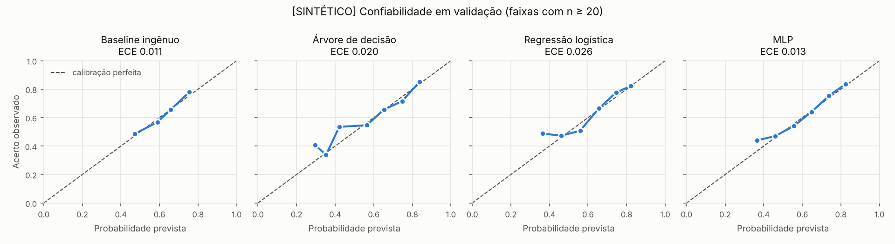

# [SINTÉTICO] Treino e avaliação em validação: Etapa 2

> **Validação, não teste.** O conjunto de teste continua lacrado. Estes números servem para escolher modelos e hiperparâmetros e não são o resultado final do protocolo. Os dados são **sintéticos**: nada aqui comprova eficácia educacional nem desempenho com crianças reais.

## Execução

| Item | Valor |
|---|---|
| Versão do pipeline | treino-v2.0 |
| Execução do CI | 41329660286 |
| Commit | `05bd902f495a` |
| Início (UTC) | 2026-11-01T17:10:57+00:00 |
| Dados | `sessoes_v2.csv` (sim-1.1), SHA-256 `1146439e6096f9bf…` |
| Igual ao CSV registrado no split | sim |
| Divisão | `split_v2.json`: 2800 participantes no treino (8400 linhas), 600 na validação (1800 linhas) |
| Conjuntos carregados | treino, validacao (teste lacrado) |
| Ambiente | numpy 2.4.6, pandas 3.1.0, python 3.11.17, scikit_learn 1.9.1, tensorflow 2.21.0 |
| Sementes | geral 2026; MLP [2026, 2027, 2028, 2029, 2030]; candidata 2026 |

## Desempenho em validação

| Modelo | Log loss ↓ | Brier ↓ | ROC-AUC ↑ | ECE ↓ | Erro vs. p_real ↓ |
|---|---|---|---|---|---|
| Baseline ingênuo | 0.6386 | 0.2238 | 0.6218 | 0.0112 | 0.1430 |
| Árvore de decisão | 0.6359 | 0.2227 | 0.6261 | 0.0199 | 0.1427 |
| Regressão logística | 0.6335 | 0.2217 | 0.6368 | 0.0257 | 0.1341 |
| MLP [8]: média ± dp de 5 sementes | 0.6351 ± 0.0009 | 0.2224 ± 0.0004 | 0.6350 ± 0.0027 | 0.0231 ± 0.0051 | 0.1372 ± 0.0010 |
| MLP: semente candidata 2026 | 0.6346 | 0.2222 | 0.6340 | 0.0129 | 0.1361 |
| *Referência: `p_real` do simulador (oráculo)* | *0.5794* | *0.1976* | *0.7342* | *0.0216* | *0.0000* |

O oráculo usa a probabilidade verdadeira, que nenhum modelo pode observar. Ele mostra o melhor desempenho possível com estes dados, e sua ECE dá uma ideia do ruído de amostragem da métrica com 1800 linhas.

## Comparações preliminares em validação (bootstrap por participante)

Diferença de log loss A − B: negativo favorece A. IC de 95%, 2.000 reamostragens de participantes.

| Comparação | Diferença | IC 95% | Cruza zero? |
|---|---|---|---|
| Árvore de decisão − Baseline ingênuo | -0.0027 | [-0.0104; +0.0052] | sim |
| Regressão logística − Árvore de decisão | -0.0024 | [-0.0085; +0.0033] | sim |
| MLP − Árvore de decisão | -0.0013 | [-0.0076; +0.0052] | sim |
| MLP − Regressão logística | +0.0011 | [-0.0020; +0.0044] | sim |

> A MLP usou a validação para o *early stopping*. Suas métricas de validação são, por isso, levemente otimistas em relação às da árvore e da regressão logística, que nunca viram a validação. A regra de decisão do protocolo (seção 6) só se aplica no teste lacrado.

## Seleção de hiperparâmetros (GroupKFold, 5 folds, só no treino)

### Árvore de decisão

Escolhido: `{'max_depth': 6, 'min_samples_leaf': 100}`

| Parâmetros | Log loss CV (média ± dp) |
|---|---|
| `{'max_depth': 6, 'min_samples_leaf': 100}` | 0.6428 ± 0.0098 |
| `{'max_depth': 5, 'min_samples_leaf': 100}` | 0.6446 ± 0.0092 |
| `{'max_depth': 6, 'min_samples_leaf': 50}` | 0.6449 ± 0.0107 |
| `{'max_depth': 3, 'min_samples_leaf': 100}` | 0.6454 ± 0.0078 |
| `{'max_depth': 3, 'min_samples_leaf': 50}` | 0.6455 ± 0.0080 |
| `{'max_depth': 4, 'min_samples_leaf': 50}` | 0.6456 ± 0.0088 |
| `{'max_depth': 4, 'min_samples_leaf': 100}` | 0.6458 ± 0.0090 |
| `{'max_depth': 5, 'min_samples_leaf': 50}` | 0.6458 ± 0.0101 |
| `{'max_depth': 3, 'min_samples_leaf': 20}` | 0.6458 ± 0.0078 |
| `{'max_depth': 4, 'min_samples_leaf': 20}` | 0.6458 ± 0.0086 |
| `{'max_depth': 5, 'min_samples_leaf': 20}` | 0.6469 ± 0.0086 |
| `{'max_depth': 6, 'min_samples_leaf': 20}` | 0.6479 ± 0.0111 |

### Regressão logística

Escolhido: `{'C': 0.1}`

| Parâmetros | Log loss CV (média ± dp) |
|---|---|
| `{'C': 0.1}` | 0.6365 ± 0.0093 |
| `{'C': 1.0}` | 0.6365 ± 0.0093 |
| `{'C': 10.0}` | 0.6365 ± 0.0093 |
| `{'C': 0.01}` | 0.6369 ± 0.0087 |

### MLP

Regra: menor arquitetura com log loss <= (1 + 0.01) x melhor. Escolhida: **[8]** (121 parâmetros).

| Arquitetura | Parâmetros | Log loss CV (média ± dp) | Época de parada por fold |
|---|---|---|---|
| [8] | 121 | 0.6383 ± 0.0107 | [24, 19, 46, 29, 69] |
| [16] | 241 | 0.6394 ± 0.0093 | [36, 22, 42, 34, 13] |
| [16, 8] | 369 | 0.6387 ± 0.0118 | [20, 31, 15, 22, 34] |
| [32, 16] | 993 | 0.6386 ± 0.0096 | [12, 16, 11, 6, 10] |

| Semente | Épocas (melhor / executadas) | Log loss | Brier | ROC-AUC | ECE |
|---|---|---|---|---|---|
| 2026 | 18 / 38 | 0.6346 | 0.2222 | 0.6340 | 0.0129 |
| 2027 | 33 / 53 | 0.6363 | 0.2231 | 0.6306 | 0.0251 |
| 2028 | 70 / 90 | 0.6350 | 0.2223 | 0.6377 | 0.0257 |
| 2029 | 67 / 87 | 0.6337 | 0.2219 | 0.6379 | 0.0258 |
| 2030 | 48 / 68 | 0.6359 | 0.2227 | 0.6348 | 0.0260 |

Equivalência Keras × formato do contrato (máx. |Δp|): 5.96e-08. O modelo **não** foi exportado para o ESP32.

